<div align="center">

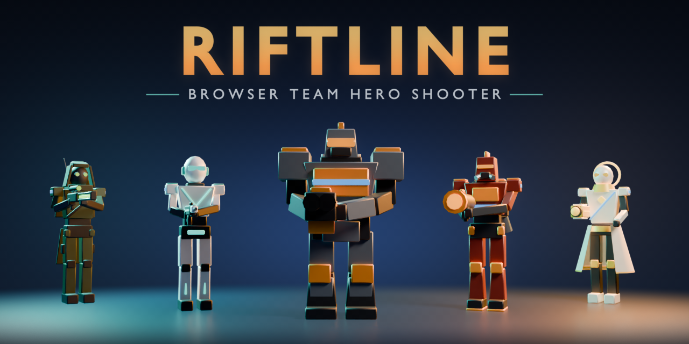

# 🎯 Riftline

**설치 없이 브라우저에서 바로 하는 5대5 팀 히어로 슈터**<br>
중앙 거점을 차지하고, 지키고, 먼저 100%를 채우는 팀이 이깁니다.

[](https://jeiel85.github.io/riftline/)
[](https://github.com/jeiel85/riftline/actions/workflows/ci.yml)
[](https://threejs.org/)
[](https://nodejs.org/)
[](assets/blender/build_assets.py)
[](LICENSE)

🌐 **[라이브 데모 플레이하기 → jeiel85.github.io/riftline](https://jeiel85.github.io/riftline/)**<br>
<sub>데모 페이지는 게임 서버 없이 브라우저 안에서 봇과 대전합니다. 친구와 온라인 대전은 <a href="#-실행-방법-getting-started">서버를 직접 실행</a>하세요.</sub>

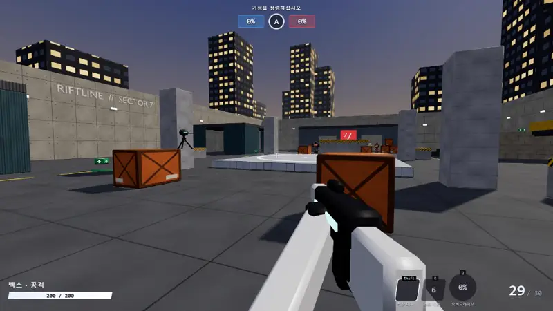

</div>

---

## ✨ 주요 특징 (Highlights)

- **🦸 히어로 5종, 역할 3가지**: 돌격·공격·지원 역할마다 무기, 이동기(Shift), 스킬(E), 궁극기(Q)가 모두 다릅니다. 로켓 점프, 헤드샷, 광역 치유, 벽 투시 같은 플레이가 됩니다.
- **🌐 진짜 온라인 대전**: Node.js 권위 서버와 WebSocket으로 같은 방 코드에 들어온 사람끼리 함께 싸우고, 빈자리는 봇이 채웁니다(1대1 ~ 5대5).
- **⚡ 손맛을 지키는 넷코드**: 60Hz 서버 시뮬레이션, 클라이언트 이동 예측과 서버 보정, 원격 플레이어 보간, 히트스캔 지연 보상(최대 250ms 되감기).
- **🤖 길을 찾아 싸우는 봇**: 내비게이션 그리드 A* 길찾기, 시야 기반 표적 선택, 조준 오차·반응 지연, 히어로별 스킬 사용 판단.
- **🧱 Blender로 만든 오리지널 애셋**: 캐릭터·1인칭 무기·맵·소품 16종을 [Blender 스크립트 하나](assets/blender/build_assets.py)로 절차 생성합니다. 외부 애셋은 없습니다.
- **📴 서버 없이도 플레이**: 같은 시뮬레이션 코드를 Web Worker에서 돌려, 정적 호스팅(GitHub Pages)에서도 봇전이 됩니다.
- **🔊 코드로 합성한 사운드**: 총성·폭발·치유음을 Web Audio API로 실시간 합성하고, 3D 위치에 따라 들립니다.

---

## 🦸 히어로 (Heroes)

<table>
  <tr>
    <td align="center" width="20%">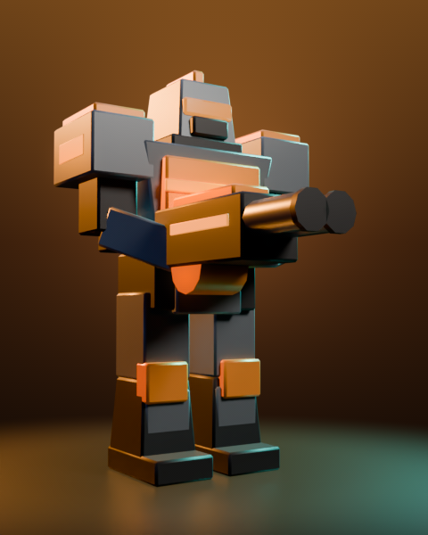<br><b>코디악</b><br><sub>🛡️ 돌격 · 강철 돌파병</sub></td>
    <td align="center" width="20%">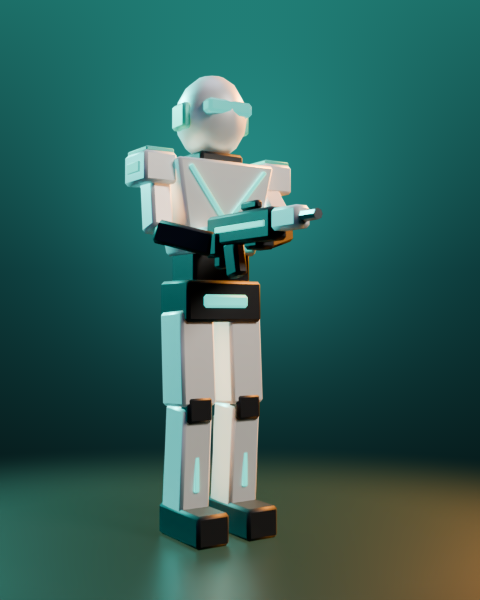<br><b>벡스</b><br><sub>⚔️ 공격 · 위상 침투자</sub></td>
    <td align="center" width="20%">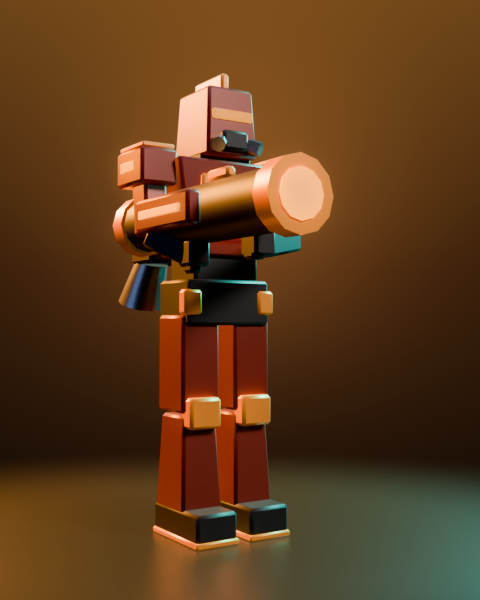<br><b>엠버</b><br><sub>⚔️ 공격 · 플라즈마 포격수</sub></td>
    <td align="center" width="20%">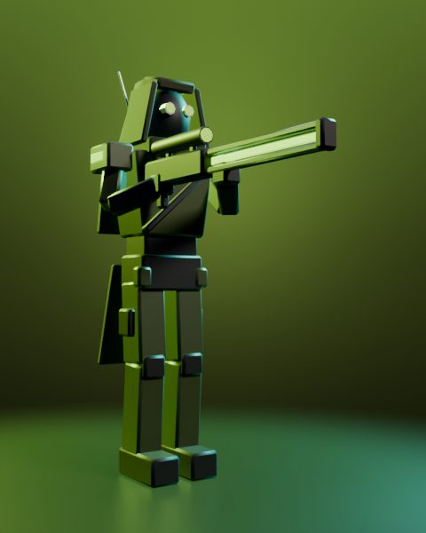<br><b>루크</b><br><sub>⚔️ 공격 · 장거리 감시병</sub></td>
    <td align="center" width="20%">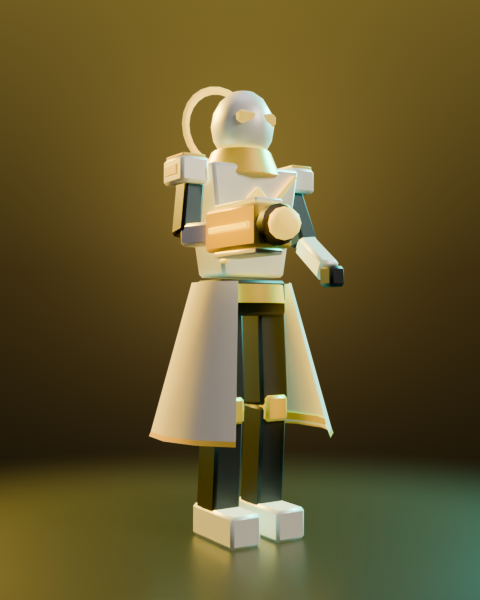<br><b>솔</b><br><sub>💚 지원 · 생명 공학자</sub></td>
  </tr>
</table>

| 히어로 | 체력 | 무기 (마우스 왼쪽) | 이동기 (Shift) | 스킬 (E) | 궁극기 (Q) |
| :--- | :---: | :--- | :--- | :--- | :--- |
| **코디악** | 450 | 스크랩 캐넌 · 근거리 산탄 | 돌진 · 부딪힌 적에게 피해, 밀치기 | 방벽 장갑 · 3초간 받는 피해 50% 감소 | **지진 강타** · 도약 후 내려찍어 광역 피해, 띄우기 |
| **벡스** | 200 | 펄스 라이플 · 연사, 헤드샷 2배 | 위상 대시 · 이동 방향 순간 돌진 | 쇼크 지뢰 · 접근한 적에게 피해, 둔화 | **오버드라이브** · 6초간 연사 2배, 이속 30%↑, 탄약 무한 |
| **엠버** | 225 | 플라즈마 런처 · 폭발탄, 로켓 점프 | 제트 부스트 · 수직 상승 | 네이팜 캐니스터 · 4초간 화염 지대 | **유성 낙하** · 조준 지역 연속 폭격 |
| **루크** | 175 | 레일건 · 저격, 헤드샷 2.5배, 조준경 | 그래플 점프 · 뒤쪽 위로 도약 | 센트리 드론 · 15초간 자동 사격 | **정찰 펄스** · 8초간 팀 전체 벽 투시, 피해 30%↑ |
| **솔** | 225 | 바이오 구슬 · 아군 치유 / 적 피해 | 글라이드 스텝 · 미끄러지듯 이동 | 회복 파동 · 주변 8m 아군 80 회복 | **성역** · 6초간 치유·피해 감소 돔 |

<sub>모든 수치는 [shared/heroes.js](shared/heroes.js) 한 곳에서 관리합니다.</sub>

---

## 🗺️ 맵 · 케스트럴 야드 (Kestrel Yard)

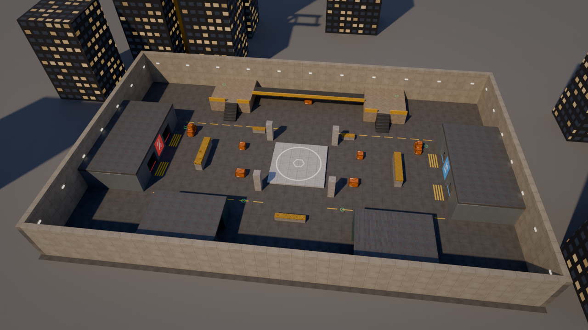

도시 한가운데 화물 야드. 양쪽 스폰룸에서 나와 중앙 거점 **A**를 두고 싸웁니다. 한 팀만 거점 위에 있으면 8초(인원이 많을수록 빨라짐) 만에 점령하고, 거점을 가진 동안 그 팀 점수가 오릅니다. 먼저 **100%** 에 닿으면 승리하지만, 그 순간 상대가 거점 위에 있으면 99%에서 멈춰 추가 시간이 이어집니다. 고지대 플랫폼·계단·다리·엄폐물·체력 팩이 좌우 대칭으로 놓여 있습니다.

## 📸 스크린샷 (Screenshots)

<table>
  <tr>
    <td width="50%">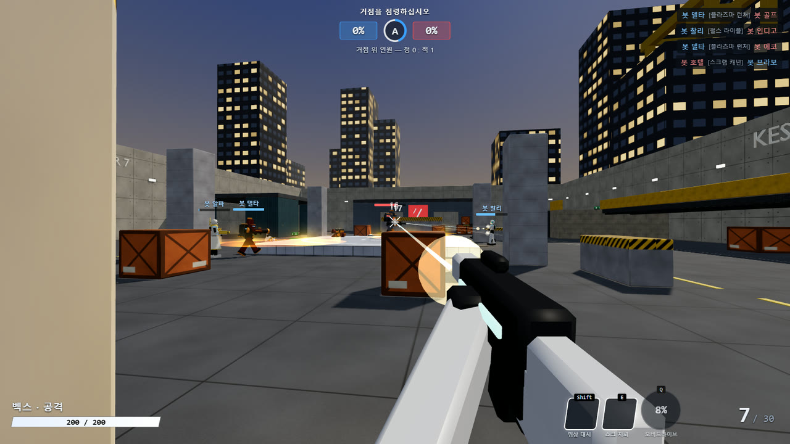</td>
    <td width="50%">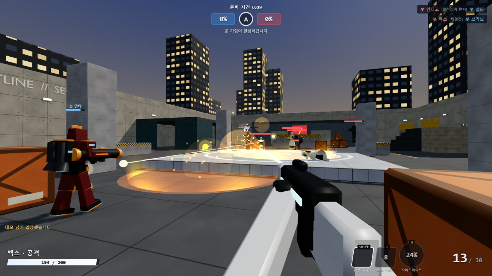</td>
  </tr>
  <tr>
    <td colspan="2">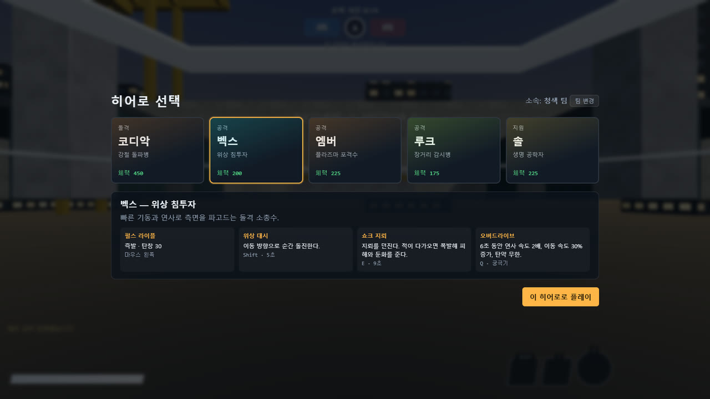</td>
  </tr>
</table>

---

## 🕹️ 조작 (Controls)

| 입력 | 동작 | 입력 | 동작 |
| :---: | :--- | :---: | :--- |
| **WASD** | 이동 | **Shift** | 이동기 |
| **Space** | 점프 | **E** | 스킬 |
| **마우스 왼쪽** | 사격 | **Q** | 궁극기 |
| **마우스 오른쪽** | 조준경 (루크) | **R** | 재장전 |
| **Tab** | 점수판 | **H** | 히어로 변경 (스폰룸·사망 중 즉시, 그 밖엔 다음 부활 때) |
| **Enter** | 채팅 | **Esc** | 일시정지 (감도·시야각·음량, 나가기) |

키보드와 마우스가 있는 데스크톱 브라우저(Chrome·Edge·Firefox 최신)를 기준으로 합니다. 터치 조작은 없습니다.

---

## 🚀 실행 방법 (Getting Started)

| 방법 | 할 수 있는 것 | 필요한 것 |
| :--- | :--- | :--- |
| 🌐 [라이브 데모](https://jeiel85.github.io/riftline/) | 혼자 봇과 대전 | 브라우저 |
| 🖥️ 서버 직접 실행 | 같은 방 코드로 친구와 온라인 대전 + 봇 | Node.js 22 이상 |

```bash
git clone https://github.com/jeiel85/riftline.git
```

```bash
cd riftline
```

```bash
npm install
```

```bash
npm start
```

브라우저에서 `http://localhost:8080` 을 열고 닉네임과 방 코드를 넣으면 입장합니다. 서버 콘솔에 같은 네트워크용 주소(`http://192.168.x.x:8080`)도 함께 출력되니 친구에게 알려 주세요. 처음 실행할 때 Windows 방화벽이 Node.js 의 네트워크 접근을 물으면 **개인 네트워크**를 허용해야 다른 PC 에서 들어올 수 있습니다.

| 환경 변수 | 기본값 | 설명 |
| --- | --- | --- |
| `PORT` | `8080` | HTTP·WebSocket 포트 |
| `HOST` | `0.0.0.0` | 바인딩 주소(`127.0.0.1` 이면 이 PC 에서만 접속) |

### 🌍 친구와 인터넷으로 하기

서버 하나가 정적 파일과 WebSocket(`/ws`)을 같은 포트로 제공하므로 아래 중 하나면 됩니다.

1. **공유기 포트 포워딩**: 서버 PC 의 `8080` 포트를 열고 `http://<공인 IP>:8080` 을 알려 줍니다.
2. **클라우드 배포**: WebSocket 을 지원하는 Node 호스팅(컨테이너 실행 가능한 곳)에 올립니다. 저장소의 [Dockerfile](Dockerfile) 을 쓸 수 있고, HTTPS 로 서비스하면 클라이언트가 자동으로 `wss://` 로 접속합니다.

> [!WARNING]
> 서버에는 계정·인증이 없어서 방 코드만 알면 누구나 들어올 수 있습니다. 공개 인터넷에 열기 전에 [하드닝 후보 이슈](https://github.com/jeiel85/riftline/issues/1)를 확인하세요.

---

## 🏗️ 구조 (Architecture)

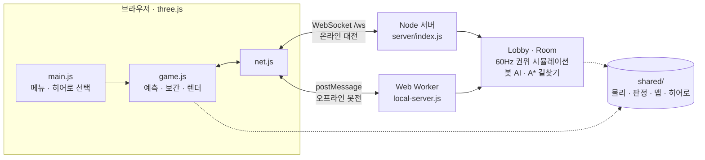

- 서버는 **60Hz** 로 시뮬레이션하고 **30Hz** 로 스냅샷을 보냅니다.
- 클라이언트는 서버와 **같은 이동 코드**([shared/physics.js](shared/physics.js))로 자기 움직임을 예측합니다. 서버 결과와 다르면 아직 확인받지 못한 입력을 다시 적용해 부드럽게 보정합니다.
- 히트스캔은 클라이언트가 보던 시점(최대 250ms 전)으로 상대 위치를 되감아 판정합니다.
- 라이브 데모는 같은 `Lobby`·`Room` 코드를 Web Worker 에서 돌리고, WebSocket 대신 `postMessage` 로 같은 메시지를 주고받습니다.

```text
server/   index.js(HTTP·WebSocket) lobby.js(방·접속) room.js(권위 시뮬레이션) bot.js(봇 AI) nav.js(길찾기)
shared/   서버·클라이언트 공용: 상수, 히어로, 맵 데이터, 이동 물리, 광선 판정, 프로토콜 검증
client/   index.html, main.js(화면 흐름) net.js game.js world.js effects.js characters.js hud.js audio.js local-server.js
assets/   blender/build_assets.py(애셋 생성) blender/render_promo.py(README 이미지) models/*.glb
tools/    gen-map.mjs build-assets.mjs check-assets.mjs smoke-test.mjs build-pages.mjs
test/     물리·판정·방·로비 단위 테스트
docs/     ASSETS.md(애셋 규격) images/
```

설계 결정과 그 이유는 [DECISIONS.md](DECISIONS.md) 에 있습니다.

---

## 🧪 개발 (Development)

| 명령 | 하는 일 |
| :--- | :--- |
| `npm test` | 물리·판정·방·로비 단위 테스트 |
| `npm run smoke` | 실제 서버를 띄워 WebSocket 클라이언트로 접속·입력·채팅·악성 입력·정적 파일 경로 확인 |
| `npm run check:assets` | GLB 애셋이 [규격](docs/ASSETS.md)(노드 이름·바운딩·삼각형 수)을 지키는지 검사 |
| `npm run build:pages` | GitHub Pages 용 정적 빌드(`dist/`). `main` 에 푸시하면 CI 가 자동 배포 |
| `npm run gen:map` | 맵 레이아웃 [tools/gen-map.mjs](tools/gen-map.mjs) → `shared/map-data.json` |
| `npm run build:assets` | Blender 5.2 헤드리스로 GLB 다시 생성(`BLENDER_PATH` 로 경로 지정 가능) |
| `blender -b --factory-startup --python assets/blender/render_promo.py` | README 배너·히어로 카드·맵 이미지(`docs/images/`) 다시 렌더 |

충돌 판정과 Blender 비주얼은 모두 `shared/map-data.json` 을 따릅니다. 주소에 `?debug` 를 붙이면 브라우저 콘솔에서 `window.riftline` 으로 게임 상태(`game`, `input`, `net`)를 볼 수 있습니다.

---

## 📜 라이선스 (License)

[MIT](LICENSE). 히어로·맵·로고를 포함한 모든 캐릭터와 애셋은 이 프로젝트를 위해 새로 만든 오리지널 디자인입니다. 기존 상용 게임의 캐릭터·명칭·디자인을 쓰지 않습니다.
